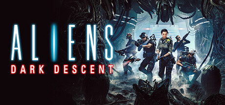

**Aliens: Dark Descent is a real-time tactical squad game where you command Colonial Marines clearing Xenomorph infestations in a tense, permadeath-adjacent campaign. Features permanent marine injuries, stress systems, and brutal Xenomorph AI that hunts your squad.**

---

## 📖 About

Aliens: Dark Descent is a real-time tactical squad game where you command Colonial Marines clearing Xenomorph infestations in a tense, permadeath-adjacent campaign. Features permanent marine injuries, stress systems, and brutal Xenomorph AI that hunts your squad.

## ⚠️ Problems Without Trainer

| Problem | Status |
|---------|--------|
| **Stress System** — Marines accumulating too much stress develop permanent psychological disorders | ✅ Solved |
| **Marine Permadeath** — Injured marines can die permanently if medical resources are unavailable | ✅ Solved |
| **Nest Detection** — Triggering a hive causes swarm responses requiring extraction or defensive action | ✅ Solved |
| **Supply Scarcity** — Ammo, medical supplies, and equipment require careful rationing across missions | ✅ Solved |

## ✅ Solution

The **Aliens: Dark Descent Trainer** solves all these issues by giving you complete control over the game.

## 🎯 Full Feature List

- Unlimited Resources
- God Mode / Invincibility
- Instant Skill Cooldown
- One-Hit Kill
- Freeze Game Timer
- Unlock All Items & Achievements
- Custom Speed Multiplier
- Save State Anywhere

## 🚀 Quick Start

1. **Disable Windows Defender** temporarily (trainer may trigger false positive)
2. Download the trainer from the button above
3. Launch Aliens: Dark Descent
4. Run the trainer as Administrator
5. Activate desired cheats with hotkeys

## 💎 Free vs Paid

| Feature | Free | Pro |
|---------|------|-----|
| Basic God Mode | ✅ | ✅ |
| Unlimited Resources | ✅ | ✅ |
| All Advanced Cheats | ❌ | ✅ |
| Auto-Updates | ❌ | ✅ |
| Priority Support | ❌ | ✅ |

## 💻 Requirements

- Windows 10/11 (64-bit)
- Aliens: Dark Descent (any version)
- .NET Framework 4.8+
- DirectX 11+

## 🍎 macOS

macOS users can use our alternative tool:

## ⚖️ Legal

This trainer is for educational and single-player use only. Use responsibly.

---

